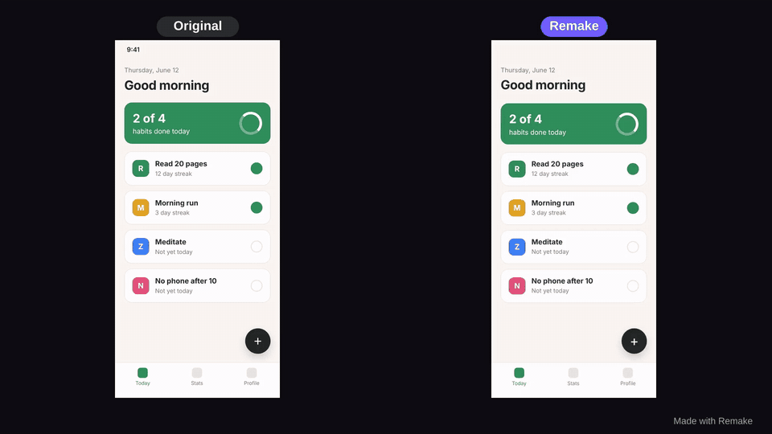
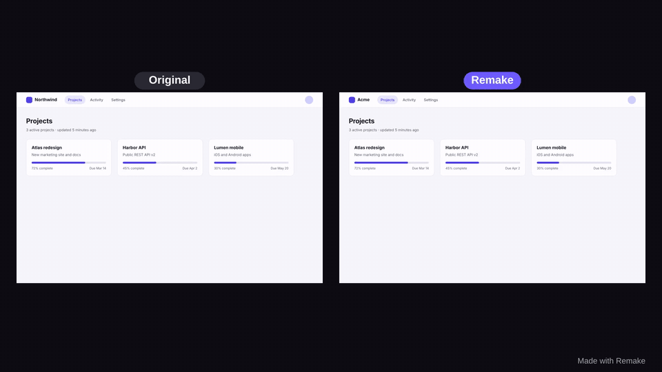
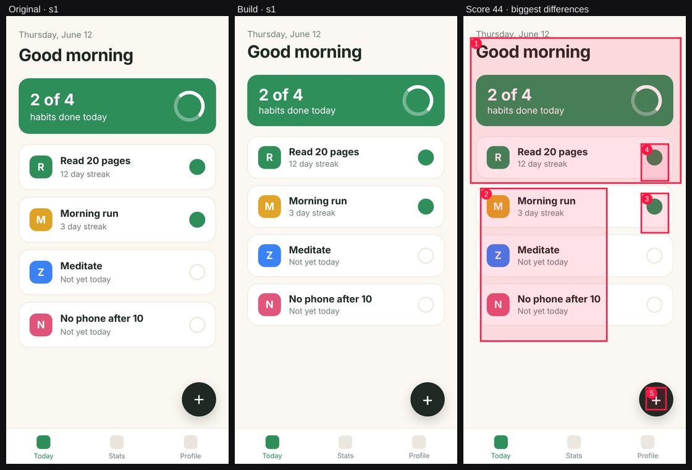
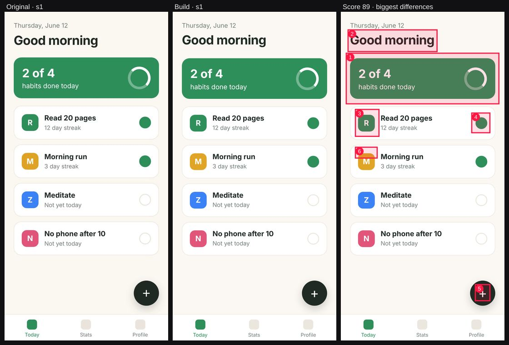

<div align="center">

# Remake

### Show it a video of any app. Get a working copy.

Give your coding agent a screen recording of a phone app, desktop app or website.
Remake lets it **watch** the video, **build** a working version, then **check its own work**: it records
the build, compares it to the original screen by screen, and fixes the differences until they match.
At the end you get a side-by-side video you can post.



<sub>Left: a 10-second screen recording. Right: the Expo app an agent built from it with Remake. 4 check rounds, final score 0.90; every screen passes.</sub>

```bash
npx remake-agents setup
```

**Works with Claude Code · Codex · Cursor · Gemini CLI · OpenCode**

MIT · runs locally · uses your own agent subscription · calls no paid APIs

</div>

---

## Quick start

1. **Install:** `npx remake-agents setup` detects your agents, adds the Remake MCP server and skill, and prints exactly what it changed. Restart your agent.
2. **Record:** make a 30–90 second screen recording of the flow you want: phone (iOS/Android screen recording), desktop app or website. An MP4/MOV file or a YouTube/Loom link both work.
3. **Ask:**
   > Remake the app in ~/Desktop/recording.mp4

   The agent watches the video, writes a spec and asks you to confirm the stack. Then it builds, checks and fixes, and finally hands you the app, a score per screen and `side-by-side-16x9.mp4` / `side-by-side-9x16.mp4`.

Needs Node 20+ and ffmpeg. If ffmpeg is missing, setup offers to download a private copy, or you can run `npx remake-agents doctor --fix` at any time.

## Examples

Both examples were made by running the full loop on the test recordings in [`fixtures/`](fixtures). The agent saw only the video, with no access to the original code. [`examples/`](examples) has the source of each remake.

| | Recording | Stack | Check rounds | Score per round | Final screens |
|---|---|---|---|---|---|
|  | 10 s desktop web app, 3 screens: card grid → project detail → settings (with a toggle) | React + Vite + Tailwind | 3 | 0.88 → 0.888 → **0.89** | s1 0.90 · s2 0.89 · s3 0.88, all pass |
|  | 10 s phone app, 3 screens: list → pushed detail → bottom sheet | Expo (React Native, checked on web) | 4 | 0.57 → 0.66 → 0.78 → **0.90** | s1 0.89 · s2 0.88 · s3 0.94, all pass |

What the loop fixed on the phone app (each one came from a `compare` diff):

| Round 1 (0.57) | Round 4 (0.90) |
|---|---|
|  |  |
| React Native's tight default line-heights pushed every row up | line-heights set to match, plus the CSS margin collapse above "12 days" reproduced |

For reference, the *real* apps score 0.97 (web) and 0.93 (phone) against their own recordings; compression and the cursor or touch dots cost a few points. A deliberately broken copy (wrong colours, missing row, changed copy) scores 0.80 and 0.64 and fails every screen.

Brand safety in action: the web recording says "Northwind", and the remake says "Acme". `compare` flags the swap, and the summary reports it.

## How it works

```mermaid
flowchart LR
    V[🎥 Recording<br/>MP4 · YouTube · Loom] --> W

    subgraph Remake MCP tools — deterministic, local
      W[watch_video<br/>states · keyframes · contact sheets<br/>animations · OCR · palette · type · spacing · transcript]
      F[infer_flow<br/>screens + transitions<br/>tap/click locations]
      G[get_frames<br/>zoom into a moment]
      R[record_build<br/>Playwright replays the flow<br/>screenshots + video]
      C[compare<br/>visual · layout · colour · text<br/>diff images + hints]
      S[make_side_by_side<br/>9:16 + 16:9 · watermark]
    end

    subgraph Your agent — does the thinking
      SPEC[Spec<br/>confirm stack]
      BUILD[Build screen by screen]
      FIX[Fix worst mismatches]
    end

    W --> SPEC
    F --> SPEC
    G -.-> SPEC
    SPEC --> BUILD --> R --> C
    C -- below threshold --> FIX --> R
    C -- all screens pass / N rounds --> S --> OUT[✅ Working app<br/>+ scores + side-by-side video]
```

Remake is **an MCP server + an agent skill + a CLI**. The tools are deterministic and tested: they measure, and the agent decides. The skill is the playbook. It tells the agent to:

1. **Watch:** `watch_video`, then write `REMAKE_SPEC.md` (screens, components, navigation flow, states, animations with durations, colour tokens, type scale, all visible text). Show the spec and confirm the stack. The defaults are React + Vite + Tailwind for web recordings and Expo for phone recordings.
2. **Build** screen by screen with realistic mock data, including the measured animations and transitions.
3. **Check:** `record_build` → `compare`, then fix the worst mismatches first. Repeat until every screen passes (score ≥ 0.85 and no metric < 0.6) or 5 rounds are done, then report the scores honestly.
4. **Show:** `make_side_by_side` plus a short summary of what matches and what doesn't.

### The tools

| Tool | What it does |
|---|---|
| `watch_video(path_or_url, budget)` | Downloads links with yt-dlp (only content you have rights to). Finds UI states and transitions with timestamps using ffmpeg scene detection (`scdet`), a frame-difference curve and perceptual-hash dedupe. Returns downscaled keyframes and **contact sheets** (many frames in one image). Detects animation segments and reports start, duration, kind (fade, fade-up, slide-left, scroll, …) and rough easing. OCRs all text with boxes (Tesseract via tesseract.js, Apache-2.0). Extracts a colour palette with roles, an approximate type scale and spacing, and the status bar to crop. Transcribes narration with whisper.cpp or faster-whisper if one is installed. |
| `get_frames(path, timestamps[])` | Exact frames on demand, so the agent can zoom in. |
| `infer_flow(path)` | A navigation graph (nodes, edges, mermaid), with each transition's probable trigger: tap/click location from frame diffs, cursor tracking and touch-indicator detection, the text under it, and the edge kind (navigation / overlay / back / scroll). Also returns `replaySteps` for `record_build`, paced like the original. |
| `record_build(url, steps)` | Runs the build in Chromium via Playwright, at a phone viewport for phone recordings. It can start your dev server (`start_command`) or serve a built folder (`serve_dir`). Replays the flow, waits for animations to settle, captures a named screenshot per step and records a video. Picks elements that are actually visible and on top, and reports console and page errors. |
| `compare(original_frames, build_frames)` | A per-screen score built from structural similarity, layout-box overlap, colour difference (ΔE) and OCR text match. Comes with a diff image and a ranked list of mismatches with hints, e.g. *missing text "Due Apr 2"*, *colour #2f8f5b vs #e11d48*, *element missing in build*. |
| `make_side_by_side(original, build)` | 9:16 and 16:9 MP4s (plus an optional GIF). By default it detects the screen changes in both videos and lines them up. A small **"Made with Remake"** label is on by default; `watermark: false` removes it. |

There is also a `remake` **MCP prompt** carrying the full playbook, for clients that support prompts.

## Token and cost notes

Remake calls no paid APIs. All analysis runs on your machine, and the only "cost" is the tokens your own agent spends reading tool results. Measured on the 10-second fixtures:

| Call | Text | Images |
|---|---|---|
| `watch_video` budget `low` | ~1.6k tokens | 1 contact sheet, ~0.3–1k tokens |
| `watch_video` budget `normal` (default) | ~1.6k tokens | 2 sheets (screens + transitions), ~2–3.2k tokens |
| `watch_video` budget `high` | ~1.6k tokens | up to 4 sheets, ~3–4.6k tokens |
| `infer_flow` | ~1.3k tokens | none |
| `compare`, per round | ~1.2k tokens | up to 3 diff images, ~3.4k tokens |

For 30–90 second recordings there are hard caps: at most 10 / 20 / 40 keyframes and 1 / 2 / 4 contact sheets for low / normal / high, at most 2,400 analysed frames, and videos up to 10 minutes. The full analysis JSON is written to `./.remake/` so the agent can re-read numbers without re-running anything. A full remake of a 3-screen app typically takes 3–5 check rounds.

## Honest limits

- **Long videos.** 30–90 s of focused flow works best. Longer recordings are sampled more sparsely and usually contain repeats. Trim to the part you care about.
- **Complex backends.** Remake rebuilds what's on screen. Real data, auth, payments, sync and business logic are mocked.
- **Games and canvas-heavy apps.** Physics, 3D, video and continuous animation don't map well to "states and transitions".
- **Pixel-perfect isn't the goal.** Fonts that aren't open-licensed are replaced with close system or open fonts. Expect scores around 0.85–0.95 for good remakes; the real app scores ~0.93–0.97 against its own recording.
- **Trigger detection is a best guess.** With visible touches or a cursor it's usually right. When a tap and a fast transition start on the same frame, it can miss, and `infer_flow` says so in `notes`.
- **Animation easing is approximate.** Durations are measured to one frame (~33 ms at 30 fps). Easing is the closest standard curve, and springs are reported as "spring".
- **OCR** is Tesseract: good on UI text, weaker on tiny, stylised or non-Latin text (English data ships by default).
- **Phones are checked on the web.** Expo builds are recorded via React Native Web, so native-only components aren't compared.

## FAQ

**Is this legal? Can I clone any app?**
Remake is for **prototyping, learning and rebuilding your own designs**. UI layouts and interaction patterns are often not protectable, but logos, brand names, icons, illustrations, copy and code are. Respect copyrights and trademarks. Don't ship a copy of someone else's product, and only download videos you have rights to use. This isn't legal advice; when in doubt, ask a lawyer.

**What does "brand safety" do?**
By default the skill tells the agent to replace logos, brand and product names, and trademarked icons with neutral placeholders (a generic name, a simple shape, open icons such as Lucide), and to tell you what it replaced. If the design is yours, say so and ask it to keep the branding.

**Does my video get uploaded anywhere?**
No. Remake runs locally, and the video never leaves your machine, except as frames your own agent reads, the same way it reads any file you give it. Links are downloaded locally with yt-dlp.

**Which agent works best?**
Any agent that can call MCP tools and read images. The skill is plain Markdown, so it works with all five supported agents.

**Can it rebuild native iOS/Android code?**
The default for phone recordings is Expo (React Native). It runs on iOS and Android and is checked on the web. Ask for SwiftUI or Kotlin instead and the agent will write those, but `record_build` can only check web-runnable builds.

## Install details

```bash
npx remake-agents setup            # detect agents, configure them, check ffmpeg + browser
npx remake-agents setup --dry-run  # show what would change, change nothing
npx remake-agents setup --agents claude,cursor
npx remake-agents doctor --fix     # check everything; download ffmpeg / Chromium if missing
npx remake-agents uninstall        # remove everything setup added (add --purge to delete ~/.remake)
```

What `setup` changes. It backs up every edited file to `~/.remake/backups/` and only ever touches entries named `remake`:

| Agent | MCP server | Skill |
|---|---|---|
| Claude Code | `~/.claude.json` → `mcpServers.remake` | `~/.claude/skills/remake/` |
| Codex | `~/.codex/config.toml` → a marked `[mcp_servers.remake]` block | `~/.codex/skills/remake/` |
| Cursor | `~/.cursor/mcp.json` → `mcpServers.remake` | `~/.cursor/skills/remake/` |
| Gemini CLI | `~/.gemini/settings.json` → `mcpServers.remake` | `~/.gemini/skills/remake/` |
| OpenCode | `~/.config/opencode/opencode.json` → `mcp.remake` | uses `~/.claude/skills` if present, else `~/.config/opencode/skills/remake/` |

JSON files are edited in place, keeping your comments and formatting. An existing server or skill named `remake` that Remake didn't create is never overwritten (unless you pass `--force`).

When you run setup through `npx`, it keeps a copy of Remake in `~/.remake/app/<version>` and points your agents at it with the absolute path of your current Node. Agents start instantly, work offline, and aren't affected by npm cache cleaning. Re-run `npx remake-agents@latest setup` to update, or after switching Node versions. If you'd rather your agents always run the newest published version through npx, use `setup --npx`.

**Optional tools:** [yt-dlp](https://github.com/yt-dlp/yt-dlp) for links. For narration, [whisper.cpp](https://github.com/ggml-org/whisper.cpp) (plus a model at `~/.remake/models/ggml-base.en.bin`) or `pipx install whisper-ctranslate2`.

**Environment variables:** `REMAKE_FFMPEG` / `REMAKE_FFPROBE` (binaries), `REMAKE_CHROMIUM` (browser path), `REMAKE_YTDLP`, `REMAKE_WHISPER_MODEL`, `REMAKE_WORKDIR` (default `./.remake`), `REMAKE_HOME` (default `~/.remake`).

**Platforms:** macOS, Windows and Linux. CI runs the full pipeline on Linux and smoke tests on macOS and Windows.

### The CLI

Every tool is also a command, which is handy for debugging or scripting:

```bash
npx remake-agents watch recording.mp4 --budget low
npx remake-agents flow recording.mp4
npx remake-agents record http://localhost:5173 --steps steps.json --viewport phone
npx remake-agents compare --original a.png,b.png --build x.png,y.png --crop-top 0.05
npx remake-agents side-by-side recording.mp4 .remake/builds/…/build.mp4 --gif
```

## Development

```bash
git clone https://github.com/AnIntellectualBeing/AITOOL2 && cd AITOOL2
npm install && npx playwright-core install chromium
npm run build && npm test        # unit + end-to-end tests on the fixture videos
npm run fixtures                 # re-record the fixture videos from fixtures/apps
node scripts/eval.mjs            # optional: full loop with a headless agent (claude -p); not run in CI
```

See [CONTRIBUTING.md](CONTRIBUTING.md).

## License

MIT. Bundled OCR data comes from [@tesseract.js-data/eng](https://www.npmjs.com/package/@tesseract.js-data/eng) (MIT). ffmpeg isn't bundled; Remake uses yours or downloads a separate copy only if you ask it to.
